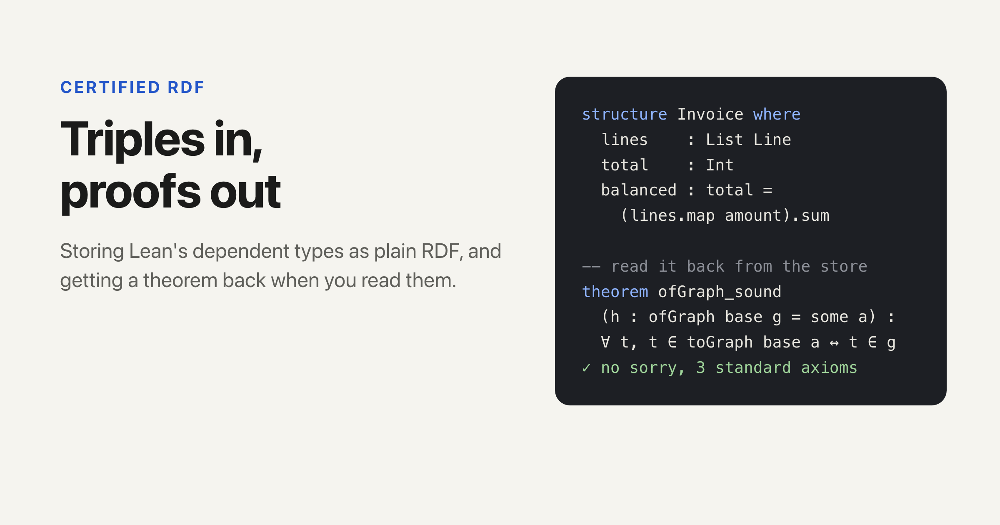
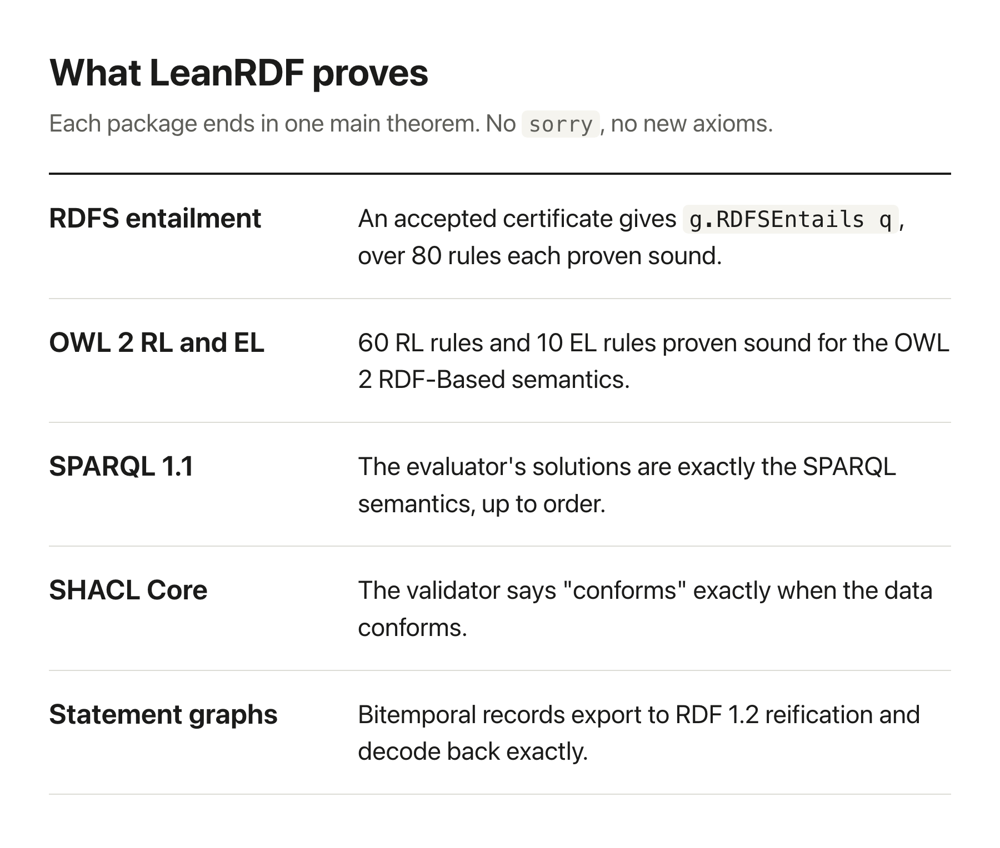
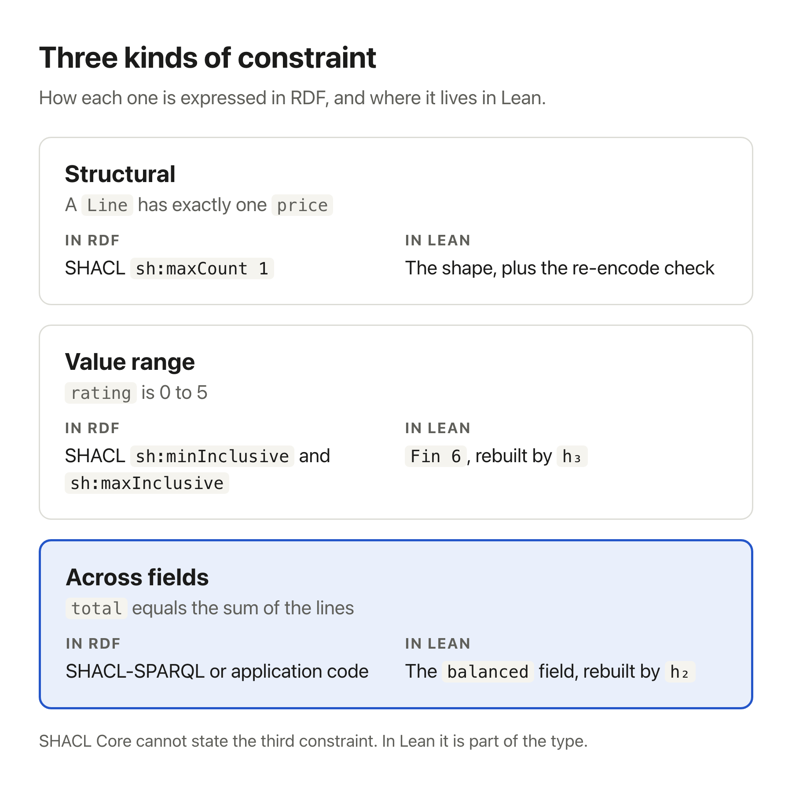
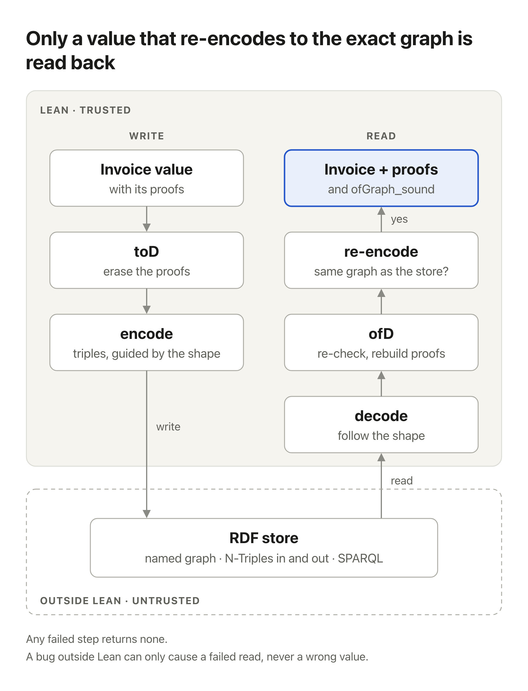

# Certified RDF: Bridging Triples and Dependent Types

### How to store proof-carrying Lean objects as plain RDF triples, and get a theorem back when you read them



---

## Your triple store is a theorem you never checked

Every RDF system makes promises it cannot show you. The parser promises that the file you loaded is the graph it holds. The reasoner promises that each inferred triple follows from the data. The application promises that the `Invoice` it wrote is the `Invoice` it will read back, with its total still equal to the sum of its lines.

We test these promises with examples, and examples only cover the cases someone thought of. When two engines disagree on an entailment, or a round trip through the store quietly drops a field, nothing tells you which side is wrong.

This post is about turning those promises into theorems. It has two parts. First, what **certified RDF** looks like in practice, using [LeanRDF](https://volland.github.io/rdf-lean/): RDF 1.2 and its semantics written in Lean 4, with untrusted engines doing the search and a proven checker doing the judging. Second, and new: how to take a real Lean type, with nested objects, lists, optional fields and invariants that are themselves dependent types, write it into an RDF store as plain triples, and get a proof back when you read it.

## Certified RDF: engines find, Lean checks

The idea is simple: let a fast, untrusted engine search for an answer, and have it return evidence that a small checker, proven correct once, can verify. In LeanRDF the data model is a plain Lean inductive type, exactly as RDF 1.2 Concepts defines it, triple terms included:

```lean
inductive Term where
  | iri (i : IRI)
  | bnode (b : BlankNode)
  | lit (l : Literal)
  | triple (s p o : Term)      -- RDF 1.2 triple terms

structure Triple where
  s : Term
  p : Term
  o : Term
```

On top of this sit the W3C semantics as Lean definitions: simple, RDF and RDFS entailment, OWL 2 RL and EL, SPARQL 1.1 and SHACL Core. Each package ends in one main theorem.



The search runs elsewhere. Elpi (λProlog) or the [oxilite](https://oxilitedb.com) SQLite store saturates the graph and writes a proof certificate. The checker accepts or rejects it. A bug in the search can only produce a rejected certificate, never a wrong theorem:

```lean
def cert : Certificate :=
  (entailmentCertificate g q).toOption.getD default

theorem g_entails_q : g.RDFSEntails q :=
  checkQueryB_sound (c := cert) (by native_decide)
```

There is no `sorry` and no new axiom in the libraries, and no Mathlib dependency. The parsers pass the W3C RDF 1.1 and 1.2 suites, and the SHACL validator passes 98 of 98 Core tests.

That covers the graph. It does not yet cover what applications actually store: objects.

## The gap: triples are flat, types are not

A triple store holds a set of `(subject, predicate, object)` facts and nothing else. It has no notion of "this is one `Person`", no notion of field order, of a required field, or of a total that must equal the sum of the lines.

A Lean type carries all of that. Here is an invoice whose invariants are part of the type itself:

```lean
structure Invoice where
  lines    : List Line
  total    : Int
  rating   : Fin 6          -- 0 to 5, by construction
  nonempty : lines ≠ []
  balanced : total = (lines.map Line.amount).sum
```

`nonempty` and `balanced` are not comments or validators. They are proofs, so a value of type `Invoice` that breaks them cannot exist. `Fin 6` is a dependent type too: a number paired with a proof that it is less than 6.

The question is how to cross between these two worlds without losing anything:

1. **Writing** an `Invoice` must give ordinary RDF that any SPARQL engine can query: no blobs, no Lean-specific encoding.
2. **Reading** must either give back a real `Invoice`, proofs included, or fail. It must never return something that is "mostly" the graph.
3. **Both directions** must come with theorems, not tests.

The usual answer is an ORM-style mapper plus a SHACL shape, maintained by hand and kept in sync by hope. The rest of this post builds the alternative in about 300 lines of Lean.

## Encoding complex objects: a universe of shapes

The bridge is a classic dependent-types construction, a *universe*: a small datatype of codes for what the store can hold, plus a function that maps each code to a real Lean type.

```lean
mutual
inductive Shape where
  | str | int | bool
  | list (s : Shape)
  | obj  (cls : IRI) (fs : Fields)

inductive Fields where
  | nil
  | req (p : IRI) (s : Shape) (rest : Fields)  -- required
  | opt (p : IRI) (s : Shape) (rest : Fields)  -- optional
end

mutual
def Shape.Denote : Shape → Type
  | .str => String | .int => Int | .bool => Bool
  | .list s => List s.Denote
  | .obj _ fs => fs.Denote

def Fields.Denote : Fields → Type
  | .nil => Unit
  | .req _ s fs => s.Denote × fs.Denote
  | .opt _ s fs => Option s.Denote × fs.Denote
end
```

`Shape` is data, so you can inspect it, generate SHACL from it or print it. `Shape.Denote` is a function from data to *types*. That one line is what plain RDF tooling cannot express: the type of a value is computed from a description that is itself a value.

A shape reads like a schema. Here is a person with a nested address, an optional email and a list of tags:

```lean
instance : Typed Person where
  shape := .obj (ex "Person")
    (.req (ex "name") .str
    (.req (ex "age") .int
    (.opt (ex "email") .str
    (.req (ex "address") (Typed.shape Address)
    (.req (ex "tags") (.list .str) .nil)))))
  toD p := (p.name, p.age, p.email,
            Typed.toD p.address, p.tags, ())
  ofD | (name, age, email, addr, tags, ()) => do
    let address ← Typed.ofD addr
    pure { name, age, email, address, tags }
  ofD_toD p := by simp [Typed.ofD_toD]
```

One encoder handles every shape. Objects get an `rdf:type` triple and one triple per field. Lists become standard `rdf:first`/`rdf:rest` chains, so order and duplicates survive. Literals use canonical XSD forms, whose round trip LeanRDF has already proven (`parseInteger_canonical`). Every node is named by its path from the root, so the same value always gives the same graph:

```
<…/alice>     rdf:type    <…/Person> .
<…/alice>     <…/name>    "Alice" .
<…/alice>     <…/age>     "34"^^xsd:integer .
<…/alice>     <…/email>   "alice@example.org" .
<…/alice>     <…/address> <…/alice/3> .
<…/alice>     <…/tags>    <…/alice/4> .
<…/alice/3>   rdf:type    <…/Address> .
<…/alice/3>   <…/street>  "Hauptstraße 1" .
<…/alice/3>   <…/city>    "Berlin" .
<…/alice/4>   rdf:first   "admin" .
<…/alice/4>   rdf:rest    <…/alice/4/1> .
<…/alice/4/1> rdf:first   "author" .
<…/alice/4/1> rdf:rest    rdf:nil .
```

That is LeanRDF's own N-Triples output, shortened. The absent `zip` writes no triple at all, which is how RDF expresses "no value". Any SPARQL engine can query this graph without knowing it came from Lean.

Decoding is *shape-directed*: the shape says which predicate to follow next, so the decoder never has to guess what kind of node it is looking at. Lists are followed with fuel bounded by the graph size, so decoding always terminates, even on a cyclic list.

## Making it verify

The user type meets the universe through one class. `toD` maps a value into its shape's denotation and forgets its proofs. `ofD` goes back, re-checks every invariant and rebuilds the proofs. A law ties them together:

```lean
class Typed (α : Type) where
  shape   : Shape
  toD     : α → shape.Denote
  ofD     : shape.Denote → Option α
  ofD_toD : ∀ a, ofD (toD a) = some a
```

`ofD_toD` is a theorem each instance must prove before it compiles. For `Address` it is `rfl`. For `Person` it follows from the law for `Address`, so nesting composes.

Reading is three steps, and the third is what makes it trustworthy:

```lean
def ofGraph (base : String) (g : Graph) : Option α := do
  let ts := g.toList
  -- 1. decode by shape
  let d ← (Typed.shape α).decode ts ts.length (node base [])
  -- 2. re-check the invariants, rebuild the proofs
  let a ← Typed.ofD d
  -- 3. re-encode and compare with the graph we were given
  if (toGraph base a).toList == g.toList then some a else none
```

Step 3 is translation validation: rather than trusting the decoder, write the result back and compare it with the graph you were handed. Graphs in LeanRDF are sets with a sorted `toList`, so this is an exact comparison. It gives a theorem that holds for every shape and every type, proven once:

```lean
theorem ofGraph_sound {base : String} {g : Graph} {a : α}
    (h : ofGraph base g = some a) :
    ∀ t, t ∈ toGraph base a ↔ t ∈ g
```

Read it slowly. If a read succeeds, the value you hold encodes to *exactly* the graph in the store: no triple was ignored and none was invented. A stray triple, a second `total`, an extra list cell or a misspelled predicate all make the read fail instead of being silently dropped. And because `a : Invoice`, the balance proof comes with it. Nothing remains to validate downstream.

The other direction, that every value you write can be read back, is checked by Lean per value:

```lean
def base := "http://example.org/inv/7"

theorem inv_roundtrip :
    ofGraph base (toGraph base inv) = some inv := by
  native_decide

theorem tampered_rejected :
    (ofGraph base tampered : Option Invoice) = none := by
  native_decide
```

`tampered` is the same invoice with the `total` triple changed from 1120 to 999. Its triples still fit the shape, so a schema validator would accept it. No `Invoice` can satisfy it, though, so the read returns `none`.

Be precise about trust here. `#print axioms` shows that `ofGraph_sound` uses only Lean's three standard axioms (`propext`, `Quot.sound`, `Classical.choice`). The two per-value theorems also trust `native_decide`, which runs compiled code instead of reducing in the kernel. LeanRDF's own README examples make the same trade-off.

## Dependent types as shapes

The store holds data, never proofs. Proofs are erased on the way in and rebuilt on the way out, and `ofD` is where that happens. For the invoice:

```lean
instance : Typed Invoice where
  shape := .obj (ex "Invoice")
    (.req (ex "line") (.list (Typed.shape Line))
    (.req (ex "total") .int
    (.req (ex "rating") .int .nil)))
  toD i := (i.lines.map Typed.toD, i.total,
            (i.rating.val : Int), ())
  ofD | (ls, total, r, ()) => do
    let total : Int := total   -- view the fields as Int
    let r : Int := r
    let lines ← ls.mapM Typed.ofD
    if h₁ : lines ≠ [] then
      if h₂ : total = (lines.map Line.amount).sum then
        if h₃ : 0 ≤ r ∧ r < 6 then
          pure { lines, total,
                 rating := ⟨r.toNat, by omega⟩,
                 nonempty := h₁, balanced := h₂ }
        else none
      else none
    else none
```

Each `if h : P` is a decidable check that hands back a proof `h` when it passes, and that proof goes straight into the structure. You cannot forget a check. Without `h₂` there is no value to put in the `balanced` field, and the code does not compile.

Three kinds of constraint show up here, and they map onto RDF differently.



The third kind is where dependent types earn their place. The constraint relates one field to a computation over another field's list of objects. SHACL Core cannot say it. SHACL-SPARQL can, but then the constraint lives in a query string that nothing ties to the code.

In Lean it is part of the type, and `ofD_toD` is a theorem that the check accepts every value the type allows. The proof is ten lines, and it fails to compile if anyone tightens the check without also changing the type.

The same pattern scales to types indexed by values. `Fin n` is stored as a plain `xsd:integer` and recovered with a bound check whose bound is `n` itself. A vector of length `n`, a matrix whose rows all have the same width, or a state machine record whose allowed fields depend on its state all fit: the shape stays simple, and the dependency lives in `ofD`.

## From proof to store

In a real system the store is outside Lean and untrusted, so it can be oxilite, Oxigraph or any SPARQL endpoint. What crosses the boundary is plain N-Triples, which LeanRDF prints and parses (its parsers pass the W3C RDF 1.1 and 1.2 suites).



1. **Write.** `toGraph base inv` gives a `Graph`. Serialize it with `Graph.toNTriples` and load it into the store, ideally as its own named graph, such as `<…/inv/7>`.
2. **Query.** The data is ordinary RDF, so SPARQL works on it directly: "all invoices over 1000", or "every line that sells cake". Where an answer must be certified, LeanRDF's proven SPARQL evaluator, or a certificate checked against oxilite's explanation, turns it into a theorem.
3. **Read.** Fetch the document's named graph, or a `CONSTRUCT` of everything under its base IRI, parse it, and call `ofGraph`. You get an `Invoice` with its proofs, or `none`.

The guarantee is about the exact graph you pass in, which is why the document boundary matters. `ofGraph` compares against all of it: hand it a whole dataset and the other documents' triples make the read fail, by design.

The trusted base stays small: the Lean kernel, the definitions in this post, and, for `native_decide` and the command-line tools, the Lean compiler. The store, the network, the SPARQL engine and the decoder's own search logic are all outside it. A bug in any of them produces a failed read, never a wrong `Invoice`.

This also lines up with work already in LeanRDF. The statement-graph package exports [tiramemsu](https://tiramemsu.com)'s bitemporal records as RDF 1.2 reification, with full round-trip theorems (`decode_toRDF`, `toRDF_decode`). Typed objects could ride on top of it: an `Invoice` per valid-time interval, its history queryable as RDF, each version still a proof-carrying value.

## What is not proven yet, and what comes next

The honest summary: soundness is proven for every shape and every type, and completeness is checked one value at a time.

- **General completeness.** The theorem `∀ a, ofGraph base (toGraph base a) = some a` for every shape is the next proof. It needs three lemmas: path names are injective, each subject and predicate pair occurs at most once in an encoding, and field predicates are distinct within an object. LeanRDF has already proven this kind of theorem for one fixed schema (statement graphs, checked exhaustively on all 406,901 graphs of up to 4 records). The generic version is the same argument done once over the universe.
- **Distinct field predicates.** Two fields that share a predicate make reads fail. That is safe but surprising, and a decidable `Shape.WellFormed` check should reject such shapes up front.
- **Identity.** Nodes are named by position, which is deterministic but not shareable. A reference shape, an IRI-valued field pointing at another document, is a small extension, and it is how an `Invoice` should point at its `Customer`.
- **More literals.** Language-tagged strings, decimals and dates need shape codes. LeanRDF already has proven canonical forms for decimals and booleans, and an XSD dateTime module.
- **SHACL from shapes.** A `Shape` can generate SHACL Core shapes, checked by LeanRDF's proven validator. That would give writers outside Lean the structural layer. The cross-field layer still needs `ofD`.
- **Better errors.** `Option` says no. `Except` with the first failing field or invariant would say why.

The larger point is about where the types live. RDF chose to put almost nothing in the data model, and that is why it is so good at integration. Dependent types put almost everything in the type. A universe of shapes lets each side keep its strength: the store sees open, queryable triples, the program sees values that cannot be wrong, and a theorem stands at the boundary where a mapper used to be.

*LeanRDF is open source under MIT or Apache 2.0, at [volland.github.io/rdf-lean](https://volland.github.io/rdf-lean/). The code in this post compiles against it on Lean 4.35.0.*
